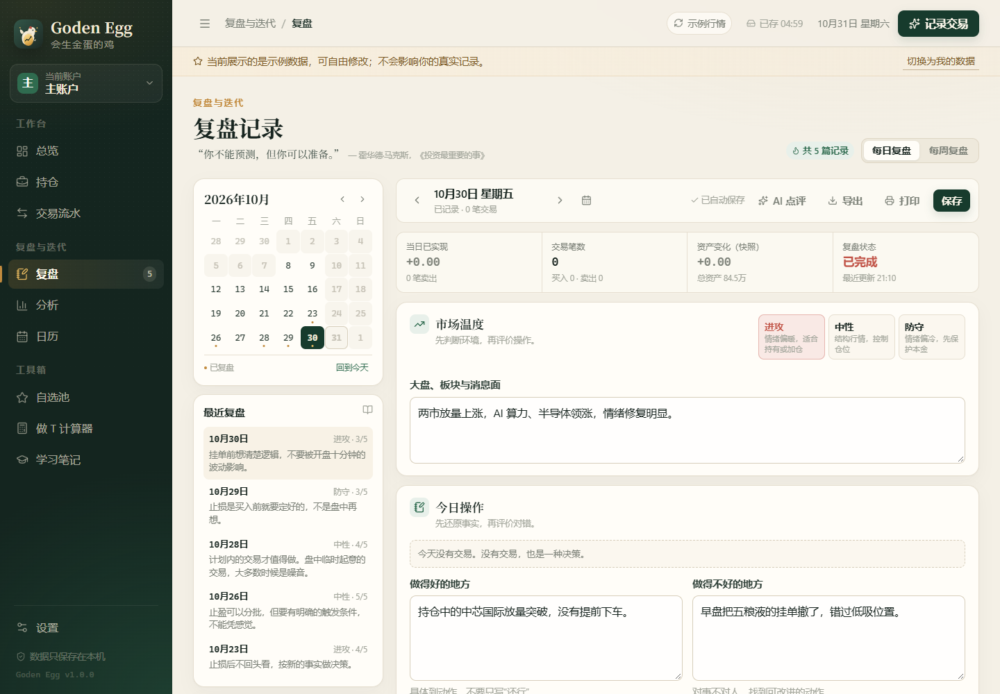
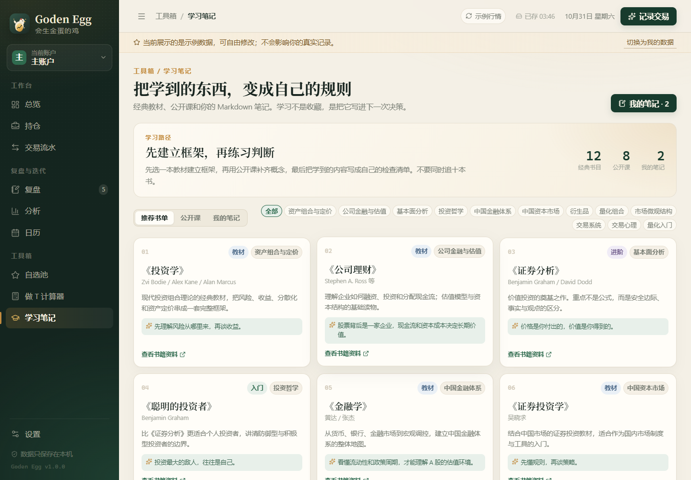

<div align="center">


# Goden Egg

**会生金蛋的鸡**

本地运行的轻量个人股票交易、复盘与学习工作台。

[](https://react.dev/)
[](https://www.typescriptlang.org/)
[](https://vite.dev/)
[](https://nodejs.org/)
[](#数据与隐私)
[](LICENSE)

[功能](#功能) · [截图](#截图) · [快速开始](#快速开始) · [架构](#架构) · [数据与隐私](#数据与隐私) · [A股规则](#a-股规则)

</div>

---


## Why Goden Egg

- **所有数据计算源于交易记录**：持仓、成本、盈亏、胜率都从原始交易记录实时计算，避免多份数据冲突。
- **提醒规则**：软件提前提示交易时间、休市日、费用和仓位边界。
- **本地优先**：数据存于本地，文件每日备份。
- **每日复盘**：记录市场、操作、情绪、纪律和下一步计划，形成可重复的流程。

## 功能

| 模块 | 能力 |
| --- | --- |
| **总览** | 总资产、持仓市值、累计/今日盈亏、资产曲线、持仓结构、核心持仓、今日清单、下一件事 |
| **持仓** | 加权成本、FIFO 批次、锁定/解禁、止损价、目标价、持有逻辑、标签、手动改现价 |
| **交易流水** | 买卖记录、费用自动计算、情绪与原因标签、备注、编辑/删除、CSV 导出 |
| **多账户** | 账户独立核算，支持“全部账户”合并视图；交易自动增减现金 |
| **每日复盘** | 市场温度、指数、消息面、当日操作、做得好/不好、情绪与纪律评分、经验教训、明日计划 |
| **每周复盘** | 自动汇总本周交易、已实现盈亏、胜率、复盘完成度；周度总结与下周计划 |
| **分析** | 胜率、盈亏比、平均持仓、最大回撤、月度表现、原因/情绪归因、盈亏排行、集中度 |
| **日历** | 财报、解禁、宏观事件、自定义事件；每日复盘自动出现；周末与休市日有标记 |
| **自选池** | 目标价、止损价、关注逻辑、标签；一键带入买入表单 |
| **做 T 计算器** | 佣金、过户费、印花税、净收益、盈亏平衡价、历史记录 |
| **学习笔记** | 12 本经典书目、8 门公开课、Markdown 笔记与实时预览 |
| **AI 复盘教练** | 可选接入 OpenAI 兼容接口，对复盘流程和纪律做点评，不推荐股票、不预测涨跌 |
| **数据管理** | Node 本地 JSON 存储、每日自动备份、完整备份导入/导出、示例数据、清空重来 |

## 截图

| 复盘 | 学习笔记 |
| --- | --- |
|  |  |

更多截图见 [`docs/`](docs/)。

## 快速开始

### 环境要求

- Windows 10/11（其他桌面系统也可通过浏览器使用）
- [Node.js](https://nodejs.org/) **20.19+**，推荐 22 LTS
- 现代浏览器：Edge / Chrome

### 双击启动（推荐）

1. 下载或克隆本仓库。
2. 双击根目录的 **`启动 Goden Egg.bat`**。
3. 首次运行会自动安装依赖并构建，然后打开：

```text
http://127.0.0.1:4173
```

关闭黑色命令行窗口即停止服务。数据在 `data/state.json`，不会因为关闭服务丢失。

### 命令行启动

```bash
npm install
npm run build
npm start
```

自动打开浏览器：

```bash
npm run start:open
```

## 开发

前端开发使用 Vite 热更新，同时需要 Node 数据服务：

```bash
# 终端 1：Node 数据服务（4173）
npm start

# 终端 2：Vite 开发服务器（5173，/api 代理到 4173）
npm run dev
```

打开 `http://localhost:5173`。修改 `src/` 会自动刷新；修改 `server.mjs` 或 `server/stateStore.mjs` 后需要重启终端 1。

### 常用脚本

| 命令 | 作用 |
| --- | --- |
| `npm run dev` | 启动 Vite 开发服务器 |
| `npm run build` | TypeScript 类型检查 + 生产构建 |
| `npm start` | 启动 Node 静态服务与数据 API |
| `npm run start:open` | 同上，并自动打开浏览器 |
| `npm run preview` | 预览生产构建（Vite） |

### 技术栈

- React 19 + TypeScript 5.9
- Vite 7
- Recharts 3
- date-fns / lucide-react
- 纯 CSS 设计系统，无 UI 框架
- Node.js 原生 HTTP 与文件系统

## 架构

```text
┌──────────────────────────────┐
│ Browser (React SPA)          │
│ 持仓 / 交易 / 复盘 / 笔记    │
└──────────────┬───────────────┘
               │  /api/state
┌──────────────▼───────────────┐
│ Node local server (4173)     │
│ 静态文件 + JSON API          │
└──────────────┬───────────────┘
               │  原子写入
┌──────────────▼───────────────┐
│ data/state.json              │
│ data/backups/state-*.json    │
└──────────────────────────────┘
```

### 数据 API

| 方法 | 路径 | 说明 |
| --- | --- | --- |
| `GET` | `/api/state` | 读取当前状态 |
| `PUT` | `/api/state` | 保存完整状态 |
| `DELETE` | `/api/state` | 清空状态与自动备份 |
| `GET` | `/api/info` | 数据路径、大小、最近保存时间、备份数量 |
| `GET` | `/api/health` | 服务健康检查 |

## 数据与隐私

- 当前状态：`data/state.json`
- 每日自动备份：`data/backups/state-YYYY-MM-DD.json`
- 导出的 JSON 包含账户、交易、复盘、笔记、做 T 历史、事件、快照和设置。
- 行情来自腾讯财经公开接口。
- 只有你主动点击「AI 点评」时，复盘文本才会发送到你配置的 AI 服务商。

> `data/` 已加入 `.gitignore`。请不要把真实交易记录、账户资金或 API Key 泄露。

导出数据请到 **设置 → 数据管理 → 导出完整备份**。

## 计算方法

- **持仓成本**：买入金额 + 买入费用，按剩余批次加权平均。
- **卖出成本**：先进先出（FIFO），卖出费用按成交数量比例分摊。
- **已实现盈亏**：卖出净收入 − 卖出批次成本。
- **总盈亏**：浮动盈亏 + 已实现盈亏。
- **今日盈亏**：持仓当日价格变化 + 当日卖出已实现盈亏；休市日为 0。
- **累计收益率**：总盈亏 ÷（总资产 − 总盈亏），避免已实现盈亏重复计入。
- 默认费率：佣金 0.025%（最低 5 元）、印花税 0.05%、过户费 0.001%。

## 项目结构

```text
Goden Egg/
├─ src/
│  ├─ components/             # 布局、弹窗、图表、交易表单
│  ├─ pages/                  # 总览、持仓、交易、复盘、分析、日历、自选、工具、学习、设置
│  ├─ store/                  # React 状态、Node API 同步、示例数据
│  ├─ lib/                    # 收益计算、交易日历、行情、股票/ETF 检索、Markdown、导出
│  ├─ data/
│  │  ├─ stocks.json          # A 股代码/名称/拼音/行业
│  │  ├─ etfs.json            # ETF/LOF/REIT 代码与名称
│  │  ├─ market-holidays.json # A 股休市日
│  │  └─ learning.ts          # 书单与公开课
│  ├─ types.ts
│  ├─ styles.css
│  └─ App.tsx
├─ server/
│  └─ stateStore.mjs          # JSON 读写、每日备份、原子替换
├─ server.mjs                 # 静态服务 + 数据 API
├─ docs/                      # README 截图
├─ data/                      # 运行时数据，不提交
├─ public/logo.svg
├─ 启动 Goden Egg.bat
├─ index.html
└─ package.json
```

## 贡献

欢迎 Issue 和 Pull Request。

- 提交前请运行 `npm run build`，确保 TypeScript 与生产构建通过。
- 不要提交 `data/`、`node_modules/`、`dist/` 或个人 API Key。
- 当前以个人使用为主，暂无自动化测试套件；欢迎补充 Vitest/Playwright 测试。

## 授权与致谢

- 代码以 [MIT License](LICENSE) 发布。
- 感谢 React、Vite、Recharts、date-fns、lucide-react 等开源项目。

详见 [NOTICE.md](NOTICE.md)。
